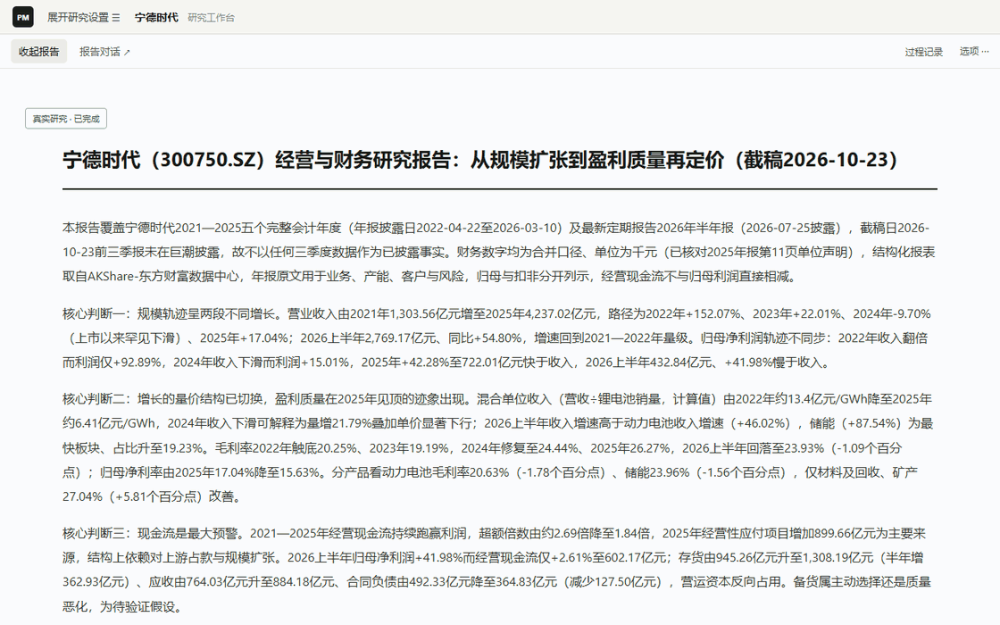
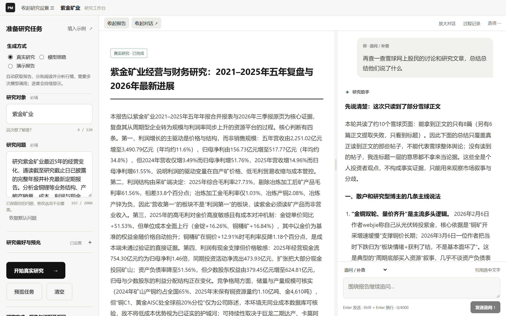
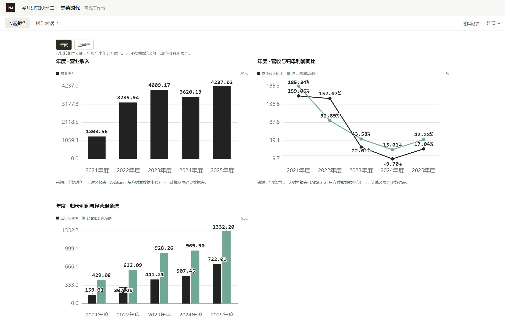
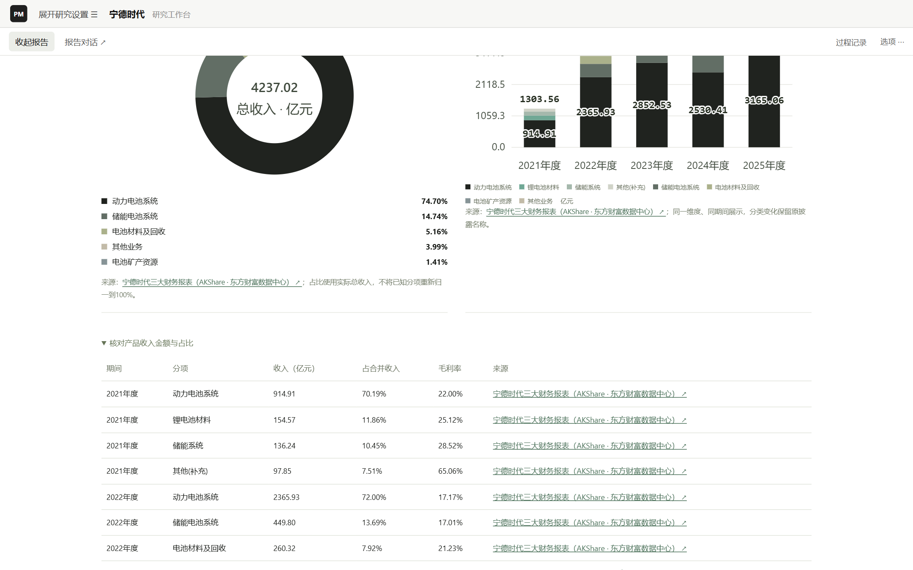
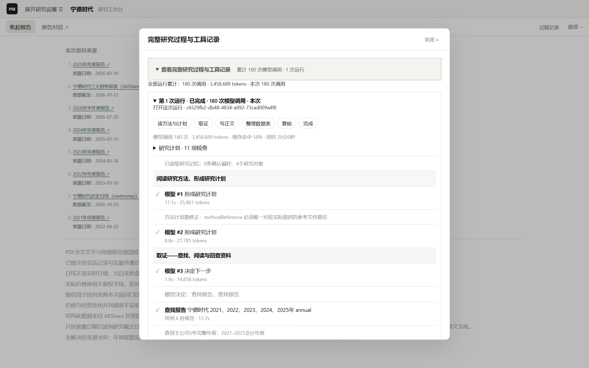
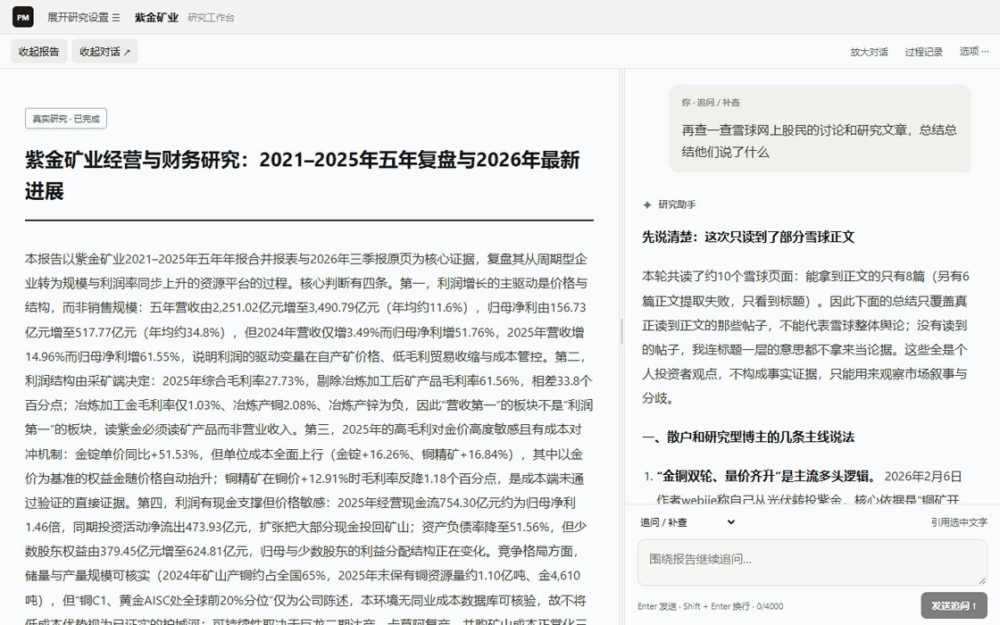
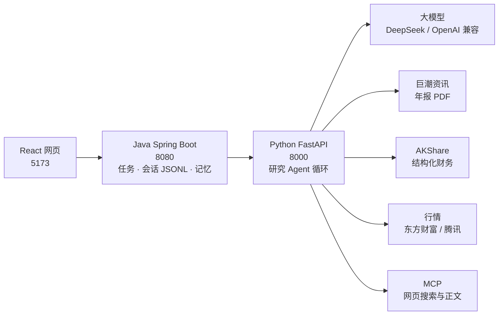

# Path of Market（市场之路）

**基于大模型的 A 股公司研究 Agent。** 输入公司、研究问题和截止日期，它自己去找年报、整本读完、取结构化财务数据和行情，写出带来源和图表的研究报告；之后可以围绕报告继续追问、补查和修订。

> 不是荐股或自动交易工具。报告区分事实、推断和缺口，数字可追溯到来源，但不等于独立审计。



<sub>真实运行结果（DeepSeek `deepseek-flash`），宁德时代 2021–2025 五年研究，截止 2026-10-23。动图为浏览已完成报告的录制。</sub>

## 一个真实案例

宁德时代，问题“公司详细情况。近期变化。”，从未读过的公司第一次研究：

| 项目 | 实际数据 |
| --- | --- |
| 自动找到并整本通读 | 5 份年报 + 1 份半年报，共 1,317 页 |
| 结构化财务数据 | AKShare（东方财富数据中心）三大报表与主营构成，按披露日过滤到截止日 |
| 产出 | 11 节正文、9 张数据表、财务/业务/行情图，每节附来源 |
| 过程 | 一次跑完：180 次模型调用、346 万 token（缓存命中 191 万）、约 20 分钟 |
| 费用 | 按 2026-10 DeepSeek 官方价格约 0.3–0.6 美元（闲时/高峰） |

同一家公司再次研究会复用已有阅读记录，用量明显更少。

## 能做什么

| 能力 | 说明 |
| --- | --- |
| 自动找资料 | 从巨潮资讯按公司、年度、截止日找官方年报/季报，不用手动上传 PDF |
| 整本阅读 | 分批读完全部页面并记录覆盖范围；扫描页用视觉模型补读；不只靠关键词搜索 |
| 结构化财务数据 | 营收、利润、现金流、资产负债及分产品/地区/行业收入与毛利率直接取自 AKShare，年报负责经营细节、产能、风险与管理层表述 |
| 行情 | 日线、后复权区间变化、回撤、波动，经营与价格并列观察但不当因果 |
| 公开网页 | 通过 MCP 搜索并通读网页正文；搜索摘要只用于发现，不当证据 |
| 报告与图表 | 模型按论点选图、自做数据表；程序逐格核对表中数字是否出现在来源里 |
| 追问与修订 | 围绕报告追问、明确补查、局部修订并保留版本与对话分支 |
| 过程可见 | 实时显示阶段、工具调用、模型用量；完成后可回放全过程 |
| 记忆 | 记住研究过的对象与主题；用户确认的偏好进入后续研究 |

| | |
| --- | --- |
|  |  |
| 工作台：设置、报告、对话可开合与拖宽 | 财务表图：同期间比较，来源可点开 |
|  |  |
| 业务结构：占比、趋势与毛利率 | 过程记录：每次模型调用与工具调用、用量与耗时 |



<sub>紫金矿业报告：放大对话阅读补查回答（如实说明只读到部分网页正文）→ 查看 7 次运行、255 次调用的完整过程（含失败与续跑）→ 版本与对话分支。</sub>

更多截图：[报告正文](docs/assets/showcase/02-report.png) · [追问回答](docs/assets/showcase/05-followup-chat.png) · [记忆与偏好](docs/assets/showcase/07-memory.png) · [资料来源](docs/assets/showcase/08-sources.png)

## Agent 是怎么做的

- **工具循环**：模型根据目标和工具结果决定下一步（11 个工具：找报告、读报告（通读/按页/关键词回查）、行情、看 PDF 原页、正文取数、MCP 网页搜索、网页通读、研究记录回查、记忆回查、偏好建议、读研究方法），程序校验参数并执行，结果回传后模型再决定补查还是写作。循环参考 [Pi](https://github.com/earendil-works/pi) 与 DeepSeek 工具协议实现，没有引入编排框架。
- **上下文管理**：完整工具结果留在记录里，每轮只投影有限要点；接近上限时摘要较早历史，原始证据可按需回查。
- **会话与恢复**：消息逐条写入 JSONL（`id`/`parentId` 分支），加执行检查点；预算用尽或中断后可从保存处继续，已读资料不重读。
- **两层约束（harness）**：提示词规定格式与边界；程序硬性核对引用来源、阅读覆盖、表格数字、图表 ID 与截止日。格式类问题自动整理，真实性问题严格把关。
- **研究方法**：按问题加载 [Anthropic financial-services](third_party/anthropic-financial-services) 原版金融研究 Skill（Apache-2.0，保留许可）形成研究计划。
- **预算**：调用次数、token、时间都有上限，按研究年限放宽，并为写作预留空间。

设计依据与来源见 [设计决策](docs/agent-design-decisions.md)。

## 架构



## 快速开始

已验证环境：Windows 11、Python 3.14、JDK 25、Node.js 24。启动脚本为 PowerShell。

1. 复制 `.env.example` 为 `.env`，填入模型密钥（推荐 DeepSeek，只填 `DEEPSEEK_API_KEY` 即可）。
2. 启动三个服务（首次会自动建 Python 虚拟环境、安装依赖、构建 Java）：

   ```powershell
   powershell.exe -NoProfile -ExecutionPolicy Bypass -File .\scripts\start-app.ps1
   ```

3. 打开 http://127.0.0.1:5173/ ，填研究对象和问题后开始“真实研究”。“演示报告”不需要密钥、不产生费用。
4. 停止：`.\scripts\stop-app.ps1`。离线测试：`.\apps\agent\.venv\Scripts\python.exe -m unittest discover -s apps\agent\tests -t apps\agent\tests`

## 模型支持

本项目的演示和全部真实验收都用 **DeepSeek API（`deepseek-flash`）** 完成，提示词也按它调试，**推荐使用 DeepSeek**。

| 服务商 | `.env` 配置 | 验证程度 |
| --- | --- | --- |
| DeepSeek | `DEEPSEEK_API_KEY`（默认） | 真实研究多家公司验收 |
| OpenAI | `LLM_PROVIDER=openai`、`LLM_API_KEY`、`LLM_MODEL` | 仅本地模拟接口测试，未做真实调用 |
| OpenAI 兼容服务（通义、Kimi、OpenRouter 等） | 再加 `LLM_BASE_URL` | 仅本地模拟接口测试 |

模型必须支持工具调用。只能经 OpenAI Responses 接口调工具的模型（如 GPT-6 Astra）和 Anthropic 原生接口暂不支持。换模型后输出格式与引用的稳定性可能不同。

## 当前局限

- 只支持沪深 A 股；单用户、本机运行；启动脚本只在 Windows 验证过。
- 第一次研究一家公司要整本读完多年年报，耗时约 20 分钟；同一家公司再研究会快很多。
- 结构化数据来自 AKShare 抓取的东方财富网页，可能是更正后的数值，接口稳定性与使用条款以数据源为准。
- 程序核对的是“数字出现在来源中”，不是独立审计；模型的推断仍需人工判断。

## 后续计划

- 近期：日常稳定性、写作阶段上下文压缩以降低成本、OpenAI Responses 适配。
- 中期：报告导出、更好的复杂表格与图片阅读、行业研究。
- 长期：板块追踪、持续变化对比、按个人研究风格发现线索。

## 开发文档

[当前进度](docs/current-state.md) · [任务板](docs/task-board.md) · [设计决策](docs/agent-design-decisions.md) · [架构](docs/architecture.md) · [开发历史](docs/history.md)。项目在 AI 编程助手协作下开发，协作约定见 [AGENTS.md](AGENTS.md)。展示素材可用 `scripts/capture-showcase.mjs` 与 `scripts/build-showcase-gifs.py` 重新生成。

## English

Path of Market is an LLM research agent for China A-share companies. Given a company, a question and a cutoff date, it finds official annual reports, reads them in full, pulls structured financials (AKShare) and market data, and writes a sourced report with charts that you can keep questioning and revising. Demo results were produced with the DeepSeek API, which is the recommended provider; OpenAI and OpenAI-compatible endpoints are supported via `.env` but only tested against a local mock.

## 许可

本项目代码采用 [MIT](LICENSE)。`third_party/` 下的第三方材料保留各自许可（Anthropic financial-services：Apache-2.0）。
