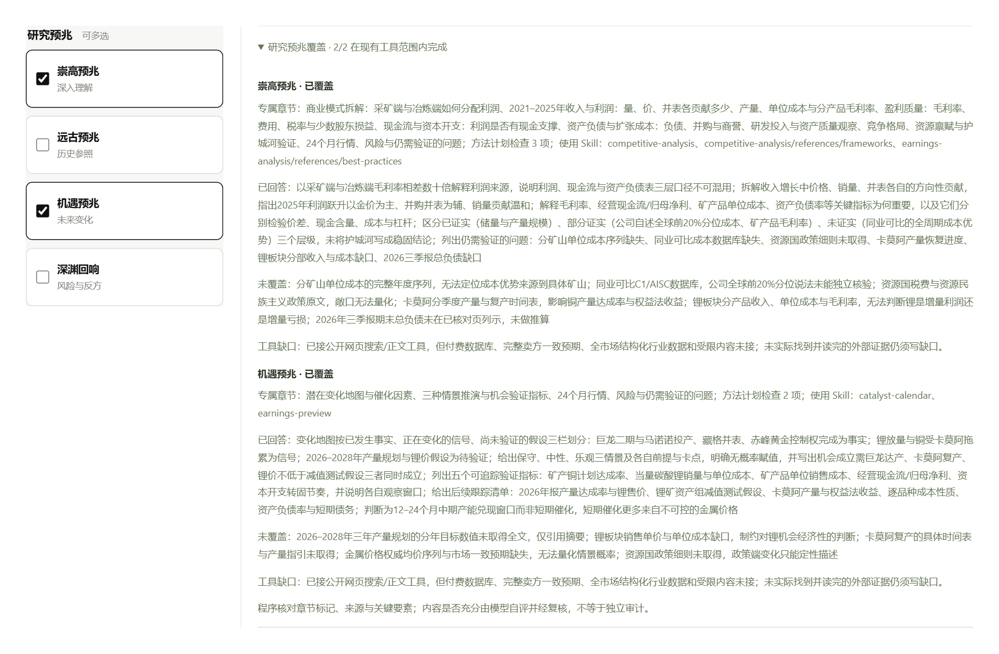
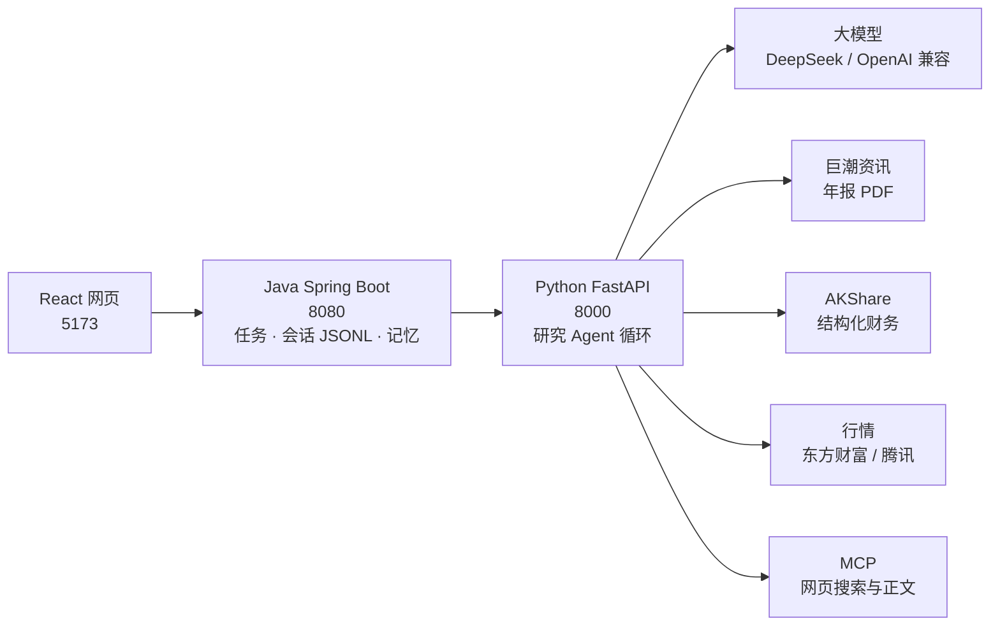

# Path of Market（市场之路）

Path of Market（市场之路）是一个基于大模型的个人财经研究工作台，内部包含研究 Agent。它帮助用户持续积累资料、比较变化，从不同视角展开有来源的分析，并发现和自己研究风格相关的线索。它不是自动交易系统，也不是荐股系统。

当前版本完成的是核心板块 **深研室**：一个研究 A 股公司的大模型 Agent。输入公司、研究问题和截止日期，它自己去找年报、整本读完、取结构化财务数据和行情，写出带来源和图表的研究报告；之后可以围绕报告继续追问、补查和修订。

> 报告区分事实、推断和缺口，数字可追溯到来源，但不等于独立审计。


<sub>真实运行结果（DeepSeek `deepseek-flash`），宁德时代 2021–2025 五年研究，截止 2026-10-23。动图为浏览已完成报告的录制。</sub>

## Agent 实现一览

不依赖 LangChain 等编排框架，核心循环、上下文、会话与校验均为自行实现，机制参考 [Pi](https://github.com/earendil-works/pi) 与 DeepSeek 官方工具协议（依据见[设计决策](docs/agent-design-decisions.md)）。

| 机制 | 做法 | 代码 |
| --- | --- | --- |
| Agent 循环 | 模型选工具 → 程序校验并执行 → 结果回传 → 模型决定补查还是写作；11 个工具，一轮可同时请求多个 | [agent_runner.py](apps/agent/app/services/agent_runner.py) |
| 长文档阅读 | 整本分批读并记录逐页覆盖；输出超限自动缩批、从断点续读；扫描页用视觉模型补读 | [runner_reading.py](apps/agent/app/services/runner_reading.py) |
| 上下文工程 | 完整工具结果存档，每轮只投影要点；接近上限时摘要较早历史，原始证据可回查；写作复用研究前缀以命中缓存 | [context_compaction.py](apps/agent/app/services/context_compaction.py) |
| 会话与恢复 | 消息逐条追加到 JSONL（`id`/`parentId` 分支）并写执行检查点；中断或预算用尽后从保存处继续，已读资料不重读 | [session_recorder.py](apps/agent/app/services/session_recorder.py) · [research_recovery.py](apps/agent/app/services/research_recovery.py) · [SessionStore.java](apps/server/src/main/java/com/pathofmarket/server/session/SessionStore.java) |
| Harness 校验 | 提示词给软约束，程序硬核对：来源须已读、表格数字逐格对原文、图表 ID、预兆章节、截止日；格式问题自动整理，真实性严格把关 | [runner_report.py](apps/agent/app/services/runner_report.py) |
| 长报告写作 | 大纲 → 逐节生成并保存 → 数据表 → 复核局部补丁；失败只重试失败的那一节 | [runner_writing.py](apps/agent/app/services/runner_writing.py) |
| 预兆与方法 | 预兆规格改变研究计划、加载的金融 Skill、必写章节与自检；方法按需读取 | [omens.py](apps/agent/app/core/omens.py) · [research_skills.py](apps/agent/app/core/research_skills.py) |
| 数据工具 | 巨潮年报、AKShare 结构化财务、行情、MCP 网页搜索与正文 | [financial_db.py](apps/agent/app/tools/financial_db.py) · [public_web.py](apps/agent/app/tools/public_web.py) |
| 预算与多模型 | 调用 / token / 时间上限并为写作预留；服务商差异档案，`.env` 切换 DeepSeek / OpenAI 兼容接口 | [runtime.py](apps/agent/app/services/runtime.py) · [config.py](apps/agent/app/core/config.py) |
| 记忆 | 跨研究的经历与主题观察；偏好须用户确认才生效 | [user_memory.py](apps/agent/app/services/user_memory.py) · [ResearchMemoryStore.java](apps/server/src/main/java/com/pathofmarket/server/memory/ResearchMemoryStore.java) |

207 项离线测试（模型用脚本化假实现）+ 多家公司真实运行验收。

## 特色：四个研究预兆

在《流放之路 2》里，预兆不替你决定结果，而是在事件发生前改变它的走向。这里也一样：开始研究前可以选 0 到 4 个**预兆**，它们不改变事实和结论的来源，只改变**往哪里看、看多深、怎么自我检查**。可以叠加，叠加时报告要平衡各个视角，不能为了篇幅牺牲任何一个。

| 预兆 | 侧重 | 让报告多看见什么 |
| --- | --- | --- |
| **崇高预兆** | 深入理解 | 从“知道公司是什么”到“理解它为什么这样运转”：商业模式、利润来源、财务质量、护城河是否有证据 |
| **远古预兆** | 历史参照 | 回到历史长河：相似周期、过往案例、行业演化与关键转折；年报范围从 5 年扩到 10 年 |
| **机遇预兆** | 未来变化 | 趋势、催化因素、情景推演与先行指标，但不把希望写成事实 |
| **深渊回响** | 风险与反方 | 主动向下看：反方论点、估值陷阱、财务压力、叙事漏洞和最坏情景 |

每个预兆不是一句提示词，而是一份完整的研究规格（[设计文档](docs/report-omens.md)）：资料偏好、必须拆出的子任务、必须写的章节、关键问题清单、自检标准和禁止事项。实际运行中它会：

- 改变研究计划，额外加载对应的金融研究方法（Skill）；
- 给模型对应的取证方向和工具提示；
- 要求报告有服务该预兆的专属章节，正文里不出现预兆名本身；
- 写完后逐个预兆自检“答了什么、没答到什么、缺哪类工具”，程序核对章节标记与来源，并在报告里展示覆盖情况。



<sub>紫金矿业报告选了“崇高 + 机遇”两个预兆：右侧列出各自的专属章节、使用的方法、已回答与未覆盖的问题，以及当前工具拿不到的数据。</sub>

## 一个真实案例

宁德时代，问题“公司详细情况。近期变化。”，从未读过的公司第一次研究：

| 项目 | 实际数据 |
| --- | --- |
| 自动找到并整本通读 | 5 份年报 + 1 份半年报，共 1,317 页 |
| 结构化财务数据 | AKShare（东方财富数据中心）三大报表与主营构成，按披露日过滤到截止日 |
| 产出 | 11 节正文、9 张数据表、财务/业务/行情图，每节附来源 |
| 过程 | 一次跑完：180 次模型调用、346 万 token（缓存命中 191 万）、约 20 分钟 |
| 费用 | 按 2026-10 DeepSeek 官方价格约 0.3–0.6 美元（闲时/高峰） |

同一家公司再次研究会复用已有阅读记录，用量明显更少。

## 深研室能做什么

| 能力 | 说明 |
| --- | --- |
| 自动找资料 | 从巨潮资讯按公司、年度、截止日找官方年报/季报，不用手动上传 PDF |
| 整本阅读 | 分批读完全部页面并记录覆盖范围；扫描页用视觉模型补读；不只靠关键词搜索 |
| 结构化财务数据 | 营收、利润、现金流、资产负债及分产品/地区/行业收入与毛利率直接取自 AKShare，年报负责经营细节、产能、风险与管理层表述 |
| 行情 | 日线、后复权区间变化、回撤、波动，经营与价格并列观察但不当因果 |
| 公开网页 | 通过 MCP 搜索并通读网页正文；搜索摘要只用于发现，不当证据 |
| 报告与图表 | 模型按论点选图、自做数据表；程序逐格核对表中数字是否出现在来源里 |
| 追问与修订 | 围绕报告追问、明确补查、局部修订并保留版本与对话分支 |
| 过程可见 | 实时显示阶段、工具调用、模型用量；完成后可回放全过程 |
| 记忆 | 记住研究过的对象与主题；用户确认的偏好进入后续研究 |

| | |
| --- | --- |
|  |  |
| 工作台：设置、报告、对话可开合与拖宽 | 财务表图：同期间比较，来源可点开 |
|  |  |
| 业务结构：占比、趋势与毛利率 | 过程记录：每次模型调用与工具调用、用量与耗时 |


<sub>紫金矿业报告：放大对话阅读补查回答（如实说明只读到部分网页正文）→ 查看 7 次运行、255 次调用的完整过程（含失败与续跑）→ 版本与对话分支。</sub>

更多截图：[报告正文](docs/assets/showcase/02-report.png) · [追问回答](docs/assets/showcase/05-followup-chat.png) · [记忆与偏好](docs/assets/showcase/07-memory.png) · [资料来源](docs/assets/showcase/08-sources.png)

## 产品蓝图：从深研室到完整工作台

深研室只是第一块。完整设想是一个能长期陪伴个人研究的工作台：研究过的东西会沉淀下来，后续变化会被追踪，再按你的研究风格挑出真正值得注意的线索。

| 板块 | 定位 | 状态 |
| --- | --- | --- |
| **深研室** | 公司（后续含行业）的深度研究、资料整合与反方检查 | **已实现**（本仓库主体） |
| **追猎者** · Pathfinder | 追踪关注公司与板块的公告、财报、新闻和市场变化，先手动检查，后加定时任务 | 计划中 |
| **锐眼** · Deadeye | 按用户画像判断哪些变化对“你”更重要，发现与个人研究风格相关的机会或风险信号 | 计划中 |
| **板块地图** | 产业链、核心公司、关键指标、催化因素与主要风险，建立行业认知 | 计划中 |
| **用户画像** | 投资风格、关注板块、观察池、风险偏好 | 部分实现：研究记忆与用户确认的偏好 |
| **研究日志** | 保存报告、假设、来源和后续问题 | 部分实现：会话、报告版本与过程可回放 |

完整的研究闭环：建立画像 → 深研室研究公司或板块 → 报告存入研究日志 → 追猎者检查后续更新 → 锐眼判断哪些更新对你更重要 → 回到深研室继续研究。产品规划见 [product-plan.md](docs/product-plan.md)。

## 架构



## 快速开始

已验证环境：Windows 11、Python 3.14、JDK 25、Node.js 24。启动脚本为 PowerShell。

> Windows 提示：第三方方法文件路径较深，请克隆到较短的目录（如 `C:\code\path-of-market`），或先运行 `git config --global core.longpaths true`。

1. 复制 `.env.example` 为 `.env`，填入模型密钥（推荐 DeepSeek，只填 `DEEPSEEK_API_KEY` 即可）。
2. 启动三个服务（首次会自动建 Python 虚拟环境、安装依赖、构建 Java）：

   ```powershell
   powershell.exe -NoProfile -ExecutionPolicy Bypass -File .\scripts\start-app.ps1
   ```

3. 打开 http://127.0.0.1:5173/ ，填研究对象和问题，选几个预兆，开始“真实研究”。“演示报告”不需要密钥、不产生费用。
4. 停止：`.\scripts\stop-app.ps1`。离线测试：`.\apps\agent\.venv\Scripts\python.exe -m unittest discover -s apps\agent\tests -t apps\agent\tests`

## 模型支持

本项目的演示和全部真实验收都用 **DeepSeek API（`deepseek-flash`）** 完成，提示词也按它调试，**推荐使用 DeepSeek**。

| 服务商 | `.env` 配置 | 验证程度 |
| --- | --- | --- |
| DeepSeek | `DEEPSEEK_API_KEY`（默认） | 真实研究多家公司验收 |
| OpenAI | `LLM_PROVIDER=openai`、`LLM_API_KEY`、`LLM_MODEL` | 仅本地模拟接口测试，未做真实调用 |
| OpenAI 兼容服务（通义、Kimi、OpenRouter 等） | 再加 `LLM_BASE_URL` | 仅本地模拟接口测试 |

模型必须支持工具调用。只能经 OpenAI Responses 接口调工具的模型（如 GPT-6 Astra）和 Anthropic 原生接口暂不支持。换模型后输出格式与引用的稳定性可能不同。

## 当前局限

- 只完成了深研室；追猎者、锐眼、板块地图仍在规划。
- 只支持沪深 A 股公司研究，行业研究尚未完成；单用户、本机运行；启动脚本只在 Windows 验证过。
- 第一次研究一家公司要整本读完多年年报，耗时约 20 分钟；同一家公司再研究会快很多。
- 结构化数据来自 AKShare 抓取的东方财富网页，可能是更正后的数值，接口稳定性与使用条款以数据源为准。
- 程序核对的是“数字出现在来源中”，不是独立审计；预兆覆盖由模型自评再经程序核对章节与来源，内容是否充分仍需人工判断。

## 后续计划

- 近期：深研室日常稳定性、写作阶段上下文压缩以降低成本、行业研究、OpenAI Responses 适配。
- 中期：**追猎者**（关注列表的公告/财报/新闻追踪，先手动后定时）、报告导出、更好的复杂表格与图片阅读。
- 长期：**锐眼**（按个人研究风格筛选变化与线索）、**板块地图**、更多预兆。

## 开发文档

[当前进度](docs/current-state.md) · [任务板](docs/task-board.md) · [设计决策](docs/agent-design-decisions.md) · [预兆设计](docs/report-omens.md) · [产品规划](docs/product-plan.md) · [架构](docs/architecture.md) · [开发历史](docs/history.md)。项目在 AI 编程助手协作下开发，协作约定见 [AGENTS.md](AGENTS.md)。展示素材可用 `scripts/capture-showcase.mjs` 与 `scripts/build-showcase-gifs.py` 重新生成。

## English

Path of Market is an LLM-based personal research workbench for China A-share investing that helps users accumulate sources, compare changes, analyze from different perspectives with citations, and spot leads that fit their own research style. It is not a trading or stock-picking system. Its first module, the Deep Research room, is an LLM agent: given a company, a question and a cutoff date, it finds official annual reports, reads them in full, pulls structured financials (AKShare) and market data, and writes a sourced report with charts that you can keep questioning and revising. Its signature feature is **omens**: four selectable research lenses (deep understanding, historical parallels, future change, risks and counter-arguments) that change the plan, methods, required chapters and self-checks of a report. Planned modules include Pathfinder (tracking changes) and Deadeye (personalized signals). Demo results were produced with the DeepSeek API, the recommended provider; OpenAI and OpenAI-compatible endpoints are supported via `.env` but only tested against a local mock.

## 许可

本项目代码采用 [MIT](LICENSE)。`third_party/` 下的第三方材料保留各自许可（Anthropic financial-services：Apache-2.0）。

“预兆”的意象借用自《流放之路 2》，“流放之路 / Path of Exile”及相关名称属于 Grinding Gear Games；本项目与其无关联、未获其认可。
