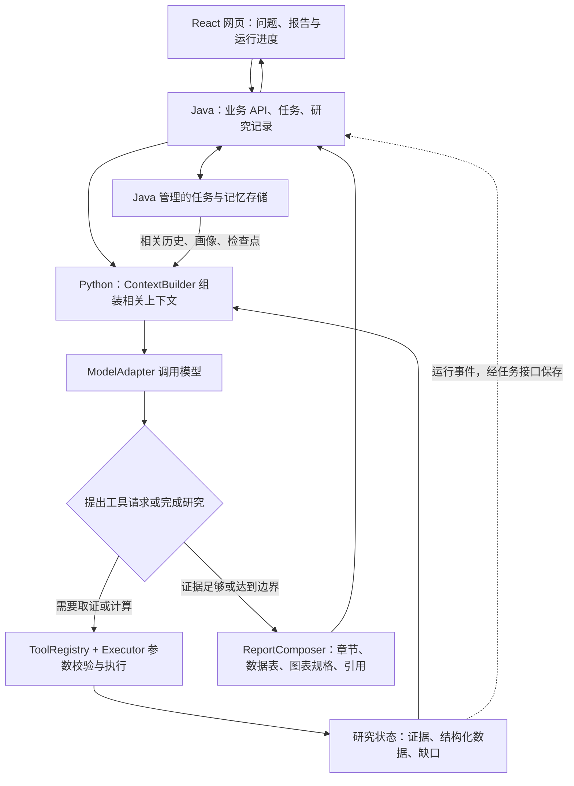

# 研究 Agent 运行架构与报告能力计划

更新：2026-10-24（Australia/Sydney）。本文件包含现状与目标，**以状态栏区分，不代表全部实现**。三应用分工与 M0 → M1 → M2 → M3 顺序沿用原计划；M1-3 已完成，下一项 M1-4。按用户要求提前接入一部分行情与表图。

## 这次明确的产品要求

- 成熟案例需要上下文组装、真实工具循环、运行记录、研究记忆和预算管理，各部分分阶段实现。
- 正式研究报告必须具备表格和图表能力，围绕问题呈现有来源的数据与关系，不能一直停留在纯文字回答。
- 保留原有完整长报告定位，支持数千至上万字的深研目标；采用分章生成、整合与续写，不能用单次输出上限代替整份报告篇幅。
- 公开报告、公开信息、行情和计算工具进入工具清单，逐项实现、检查和积累；不用一次堆齐所有工具。
- 核心机制先参考 Pi 等成熟实现与官方文档，决策见 `agent-design-decisions.md`。按用户要求采用 JSONL 追加会话与父节点分支的方向，分阶段实现；CLI/TUI、特定 SDK 和多 Agent 按实际需求选择。
- 所有选定研究资料默认完整阅读：年报、季报、公告、研报、网页正文等。系统自动找原文，长资料分批阅读并记录模型处理覆盖；搜索摘要和关键词仅用于发现与回查，缺口明确标记。

## 当前做到哪一层

| 层 | 当前实际状态 | 计划 |
| --- | --- | --- |
| 网页、Java、Python | 已完成应用骨架与模型报告展示 | 沿用三应用职责 |
| 模型客户端 | HTTP 调用 DeepSeek、原生工具消息、结束原因/结构校验、超时与用量已接 | 后续按需流式响应/其他供应商 |
| Context 组装 | 规则、当前任务、三个工具、前序消息/工具结果和有页码阅读要点，字符边界已实现 | M2-5 完善相关性选择、自动摘要与恢复 |
| 研究工具 | 八个底层工具，模型六个逻辑入口（2026-10-24）；定期报告、全文文字、原页视觉、正文取数、方法读取和沪深日线已接 | 更多来源、OCR/视觉和通用计算后续扩展 |
| Agent Loop | 模型决策→工具校验/执行→回传→补查/报告；引用/覆盖/口径复核与预算停止；预兆进入计划/上下文/写作/自检（M1-4 代码与离线验收完成） | M1-4 真实验收后进入 M2 |
| 运行状态与事件 | 进程内异步任务、父关系事件、原始工具 ID、覆盖、用量、取消/部分结果已接 | M2-1 完整事件落盘；M2-5 检查点/分支恢复 |
| 记忆 | 尚无会话/研究持久化；PDF 工具缓存不是会话记忆 | M2-1 Java SessionStore 追加 JSONL 消息/工具事件并保存研究；M2-2 画像；M2-5 分支与摘要恢复 |
| 报告呈现 | 标题/摘要/引用章节、工具与覆盖、股票行情图和指标表已实现 | M2-4 通用报告块/财务表图/侧栏；M2-6 长报告与导出 |
| 研究 Skill | 公司财务研究Skill与原版财报解读参考已加载；按问题/预兆选择原版方法，Skill 目录交给模型按需读取；预兆规格已结构化实施 | M3 通用Agent复用 |

当前网页默认真实研究，实际模型、工具和动态循环均已分别验收。原“模型思路”保留 M1-1 未检索资料的边界；切换模式不混淆证据状态。M1-3 详情见 `m1-3-agent.md`。

用户优先补充任务已实现原页视觉、核心财务同比与四类图/数据表、报告目录/段落、五个逻辑工具/八个底层工具（当时；之后新增正文取数，当前六个）；当前矩阵中PDF与财务呈现以 `financial-research-skill.md` 的最新状态为准。未完成全本视觉、通用表格提取/图型、侧栏和持久会话。

## 目标数据流



图中是目标关系，不能将全部方框视为现有代码。Python 负责模型与工具执行，Java 管理业务持久化，网页呈现结果；事件传输方式与编排库在实施对应任务时再确定。

## Context 每次需要哪些内容

| 内容 | 本项目对应物 |
| --- | --- |
| 系统规则 | 研究边界、证据要求、输出约定 |
| 研究策略 | 已选择预兆、研究方法或 Skill 中与当前任务相关的部分 |
| 用户输入与画像 | 当前问题、对象、截止日期、偏好和相关观察记录 |
| 可用工具定义 | 工具名称、用途、参数与返回约定，仅加载当前允许使用的工具 |
| 研究状态 | 已完成动作、未解决问题、当前假设、停止条件 |
| 证据与工具结果 | 相关原文、来源标识、页码、结构化指标、必要的错误信息 |
| 相关历史与摘要 | 前序工具消息、与任务相关的历史研究；长历史压缩后的摘要和原始记录入口 |

应用负责读取、筛选和传入这些内容，不能假定模型会自动知道磁盘文件、数据库或历史聊天。

开发聊天使用的 `AGENTS.md` 属于开发规范；产品内的研究规则和 Skill 必须由应用显式加载。上传报告和网页内容是待分析资料，不作为覆盖系统研究规则的指令。

ContextBuilder 分两阶段：

1. M1-3 先有明确消息结构、来源引用、最近工具结果和基本大小上限，为下一次输出预留空间；过大材料按页/片段读取。
2. M2-5 增加按相关性选择、上下文 token 估计、摘要和恢复。摘要保留对象、日期、假设、未解决问题与证据 ID；关键原始数字和单位保存在结构化记录中，可回到原文复查。

上下文窗口、单次输出预算与整份报告的累计预算分别管理；不能把所有材料、所有历史和全部 Skill 每次原样塞入请求。

## SDK、模型适配与 Agent Loop

截图里的 `from anthropic import Anthropic` 是 Anthropic SDK。SDK 封装调用方式；直接 HTTP 也能实际请求模型。我们当前使用标准库 HTTP 客户端，因此没有 `import OpenAI` 并不意味着模型尚未连接。

SDK 或模型 API 适配层只负责供应商请求、返回内容、工具调用消息、流式事件、错误和用量。ToolRegistry 与 Runner 负责执行工具、更新状态和继续循环。安装 SDK 不会自动产生财报读取、行情查询或长期记忆。

保留独立模型适配边界。先验证当前 DeepSeek 的工具调用，再按实际需求增加其他供应商；未来是否使用 SDK 或编排库，以接口维护成本和检查结果决定。当前固定关闭思考模式属于 M1-1 的调用配置；后续可按研究任务增加可配置模式，并联动输出、时间与累计预算，不能把开启思考模式当成已经取证。

## 工具与应用组件清单

下列按任务标明实际状态；已实现工具的准确参数见 `m1-2-tools.md`。

| 能力 | 接口或组件示意 | 起始任务与完成条件 |
| --- | --- | --- |
| 公司与报告发现 | `resolve_company` / `find_documents` | M1-2 年报与 M1-3 季报/半年报、当年最新定期报告补查已完成；无需手工备齐 PDF |
| 下载与 PDF 阅读 | `fetch_document` / `read_document_batch` / `read_document` / `search_document` | M1-3 已接模型分批处理、覆盖与来源缓存，默认 full；OCR/视觉仍待做 |
| 资料上传与相关片段检索 | 文档导入与 `search_documents` | M2-3：解析、分段、检索和原文定位可验证 |
| 表格与指标提取 | `extract_table` + 结构校验 | M2-4：保留行列、单位、期间和来源，数值与原报告核对 |
| 公开信息搜索 | `search_public_info` | M2-7：真实搜索服务返回标题、地址和时间，摘要能追溯到原文 |
| 公开网页读取 | `read_public_page` | M2-7：拿到页面正文与来源，搜索摘要不代替全文证据 |
| 行情查询 | `get_market_data` | M1-3 提前完成沪深日线/主备 Provider/口径来源；M2-8 继续更多市场与数据 |
| 指标计算 | 行情内 `compute_metrics`；未来 `calculate_metrics` | M1-3 已有确定性变化/回撤/波动/月度计算；通用财务与情景工具待 M2-8 |
| 图表与报告组合 | `MarketChart`；未来通用 ReportComposer | M1-3 有真实行情曲线和指标表；通用块/财务图表/长报告在 M2-4、M2-6 |
| 记忆与上下文 | SessionStore / ContextBuilder | M2-1、M2-2、M2-5：保存、检索并传回相关内容，支持恢复 |

一个工具通过参数处理不同公司、年份和问题。工具内部可以调用现成库、搜索服务或行情 Provider；功能数量、模型可见工具数量和底层函数数量不必一一对应。报告渲染、存储等组件也不必全部暴露为模型工具。

## 表格与图表是正式报告要求

M2-4 的首个验收例沿用研发投入主题：用已核对的真实报告形成研发投入比较表与趋势/对比图，标明期间、单位、口径和页码。根据资料可比较的期数选择折线或柱状图，不能用没有来源的示例数字补齐。

职责分工：

- 模型提出需要观察什么、适合什么图，并解释结果。
- Python 提取和校验数据，执行计算，产出表格和图表所用数据。
- 网页按受控图表规格渲染，支持查看数值和来源；导出时保持一致。
- Java 保存报告、图表数据、来源和版本关系。

正式财务/行情报告在有足够数据时至少包含一个相关数值表与一个相关数据图。定性报告也应使用证据对照表、时间线或关系图帮助理解。资料不足时列出未完成的表图和数据缺口，报告不能冒充完成；当前无证据的 M1-1 输出不填充假图。

图表与表格至少携带数据集标识、字段、单位、期间和来源引用；金额、百分比、币种和缺失值不可混淆。图上的数值应能与表格、计算输入和原文互相核对。

当前 Agent 报告在引用文字章节外已有独立 `marketData`，网页实际渲染行情曲线与指标表；原 mock/model 格式兼容。通用文字/表格/图表内容块、财务提取与任意图型仍需 M2-4 设计和联动校验，不能假定一句“请画图”就能生成任何图表。

## 长报告生成方式

沿用 `report-omens.md` 已有的“完整报告优先、分层阅读、分段生成”规则。

```text
研究大纲与资料需求
  → 工具调查并形成证据集与指标表
  → 按章节生成，保存章节结果与所用证据
  → 整合、检查矛盾、去重、核对引用与图表
  → 生成执行摘要和跟踪清单
  → 网页分章阅读，按需导出
```

几千至上万字属于整份报告的目标，不要求一次 API 调用完成。当前 M1-1 的默认 1800 token、程序上限 4096、2 至 6 个章节和 60 秒等待是接入阶段边界，不作为正式长报告的永久规格。

M2-6 设计完整/摘要等用户可选篇幅方式、每章输出预算、累计 token/时间预算、后台任务进度、章节检查点与续写。达到预算时保留已完成章节并标记缺口，不静默删去已选择预兆的必要内容。不能仅抬高输出上限，却继续使用短报告结构和同步短等待链路。

## 按原计划推进

1. **M1-2：真实资料与基础工具，已完成。** 程序自己查到同花顺两份完整年报，完成下载、连续分批全本原文返回、重点回查和来源验证；工具可用不代表模型已经读完。
2. **M1-3：上下文与动态循环，已完成。** 模型选工具、分批处理全文文字、回查或结束；原始工具 ID、父关系、覆盖与缺口、步数/调用/时间/token/上下文边界、实际中际旭创案例与行情图表通过。
3. **M1-4：预兆策略与 Agent 验收。** 不同问题/预兆影响调查动作；冲突补查、缺资料和预算停止均能说明。
4. **M2：积累与完整研究体验。** 保存研究与画像，增加资料检索、表图、上下文摘要和检查点、长报告、公开信息与行情工具；各任务单独实施和验收。
5. **M3：特色功能。** 在同一套资料、工具、记忆和报告能力上实现板块地图、追猎者、锐眼与研究 Skill。

M1 工具循环只需少量工具即可验收；完整产品按需求覆盖资料、市场数据、计算与报告能力，不以工具数量作为成熟度指标。本文件是当前方向，具体接口、库和数据源在对应任务中验证后可以调整。

## 参考与适用边界

- [Pi Agent Core](https://github.com/earendil-works/pi/blob/main/packages/agent/README.md)：上下文转换、工具执行和事件机制的参考，不代表要迁移到 Pi。
- [Pi Compaction](https://github.com/earendil-works/pi/blob/main/packages/coding-agent/docs/compaction.md)：历史摘要与保留近期消息的参考，不要求复制它的会话文件格式。
- [learn-claude-code 基础循环](https://github.com/shareAI-lab/learn-claude-code/blob/main/agents/s01_agent_loop.py)：模型、工具执行与结果回传的教学示例；截图项目名的语音转写不明确，此处是根据代码形态找到的相近参考，不作为截图仓库身份的唯一证明。
- [OpenAI API Overview](https://developers.openai.com/api/reference/overview)：官方说明 SDK 与直接 HTTP 都是调用途径；本项目当前实际接入的是 DeepSeek，没有在本次规划中新增 OpenAI 调用。
